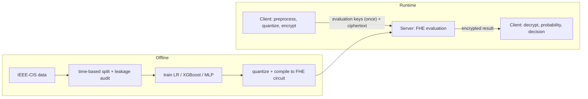

# Ciphraud

**Latency-bounded privacy-preserving fraud detection under Fully Homomorphic Encryption (FHE).**

Ciphraud is a research-style, reproduce-and-extend study. A client encrypts a transaction's features, a server scores them
without ever decrypting, and only the client can read the fraud score. The project measures what that costs in accuracy and
time for three model types on the IEEE-CIS Fraud Detection data. It is an experiment, not a product: it is not deployed, not
production-ready, and not published.

Full write-up: [`report.md`](report.md). Phase documents live in [`docs/`](docs/).

## Why this exists

Fraud models need sensitive transaction data. With FHE the scoring server can compute on encrypted inputs, so an honest-but-curious or
hardware-untrusted server never sees the features or the decision. The catch is cost, so the research question is:

> How do feature count, quantization bit-width and model complexity affect the predictive performance and computational cost of
> privacy-preserving fraud detection under FHE?

## FHE in plain language

Think of a locked glovebox: the server can reach in with gloves and rearrange what is inside, but it cannot open the box. The
client keeps the only key. In FHE the "gloves" are arithmetic on ciphertexts; the result comes back still locked, and only the client's
secret key opens it. Concrete-ML (TFHE) works on small integers, so models are *quantized* (rounded to a few bits) first. Too few bits
and the answers get wrong; more bits means more expensive encrypted computation. This project measures that trade-off.

## Architecture



The client holds the secret key. The server holds the compiled model and public evaluation keys. Four pipelines stay separate:
offline training, FHE compilation, runtime inference, benchmarking. Details: [`docs/architecture.md`](docs/architecture.md),
[`docs/client_server.md`](docs/client_server.md).

## Stack

Python 3.12, Concrete-ML 1.9.0 / concrete-python 2.10.0 (TFHE), XGBoost 1.6.2, scikit-learn 1.5.0, PyTorch + Brevitas (quantization-aware MLP),
pandas, FastAPI + uvicorn + httpx (client/server), pytest. FHE code runs on Linux only (WSL2 on the development PC). Exact pins:
`requirements-fhe.txt`.

## Key measured results

All accuracy numbers in the table are **validation-partition** numbers (time-based split). A single frozen test-partition evaluation was run afterwards, once, on 2026-10-12 (see the next section); it was not used for any selection. Latency is
the mean of five repeats of one input unless stated. See [`report.md`](report.md) for every table and caveat.

| Model (config) | PR-AUC (quantized) | Passes accuracy gate | Encrypted latency |
|---|---|---|---|
| Logistic Regression, 16-bit, top 20 / 50 / 100 features | 0.348 / 0.389 / 0.422 | yes | 8.6 / 15.4 / 30.9 ms |
| XGBoost, 14-bit, top 20 / 50 / 100 features | 0.522 / 0.543 / 0.571 | yes | 4,099 / 2,651 / 3,688 s |
| Quantized MLP, 3-4 bit, top 20 / 50 | 0.39-0.43 | **no (all six MLP configurations failed)** | 5-73 s where FHE ran |

- 8-bit quantization failed the accuracy gate for every LR and XGBoost configuration; bit-width decided accuracy more than feature count.
- XGBoost buys about 0.15-0.17 PR-AUC over LR for roughly 10^5 times the latency. XGBoost cost follows tree count, not feature count.
- A published figure of about 6 ms for encrypted XGBoost was **not reproduced** here (measured 931-4,099 s); the reason is unknown.
- Client/server round trips: LR 7/7 and MLP 7/7 exact; XGBoost one request, exact (219/219 output integers). The MLP is a pipeline demonstration only and
  is not a validated fraud model. The XGBoost run is one cold request, needed WSL memory raised to 5 GB after two aborted attempts, and is not a benchmark.
- Plaintext reference (832 features): LR PR-AUC 0.456, XGBoost 0.571.

## Frozen test-partition evaluation (run once, post hoc)

After the models, thresholds and code were frozen (`results/phase12_test_eval/freeze.json`), the sealed test partition (104,637 rows, 3,562 fraud, 3.40%) was scored once with `python -m src.analysis.test_evaluation --run` (exit 0; protocol [`docs/test_evaluation_protocol.md`](docs/test_evaluation_protocol.md); outputs `test_results.json`, `summary.md`, hashes in `run_complete.json`). Quantized test PR-AUC with 95% time-block bootstrap intervals:

| Model | top 20 | top 50 | top 100 |
|---|---|---|---|
| LR 16-bit | 0.140 [0.101, 0.229] | 0.215 [0.149, 0.334] | 0.341 [0.291, 0.389] |
| XGBoost 14-bit | 0.467 [0.418, 0.512] | 0.474 [0.426, 0.519] | 0.466 [0.420, 0.511] |
| MLP 3-bit (gate failed) | 0.305 [0.263, 0.347] | 0.360 [0.309, 0.409] | 0.355 [0.307, 0.400] |

Every configuration scored lower on the test partition than on validation (for example XGBoost top-100 0.571 to 0.466, LR top-20 0.348 to 0.140), and the ranking of feature tiers changed: for XGBoost the tiers are statistically indistinguishable on test, and the validation advantage of more features does not hold up. The 8-bit configurations remain worse than their wide counterparts. Full 18-row table, ROC-AUC and float references: [`results/phase12_test_eval/summary.md`](results/phase12_test_eval/summary.md). The explanation that earlier file-access-time changes on the sealed label file came from my own metadata inspection is circumstantial (no OS audit log exists); see section 11 of the protocol. The report ([`report.md`](report.md)) was written before this evaluation and still says "validation only"; read this section as the update.

## Setup and reproduction

Plaintext phases (Windows or Linux): `pip install -r requirements.txt`, place the Kaggle IEEE-CIS CSVs as described in
[`docs/data_acquisition.md`](docs/data_acquisition.md) (data are not in the repository), then for example
`python -m src.data.pipeline --config configs/phase2/pipeline.yaml`.

FHE phases (Linux/WSL2 only): create a venv and `pip install -r requirements-fhe.txt` (do not mix with `requirements.txt`; see
[`docs/environment.md`](docs/environment.md)). Commands for each phase, including the client/server runs and the memory requirement for
XGBoost (about 5 GB of WSL memory), are in [`docs/client_server.md`](docs/client_server.md) section 11. Every reported number maps to a script and
config in the traceability table at the end of [`report.md`](report.md).

## Tests

```
python -m pytest -q                                      # plaintext suite (Windows venv); FHE tests skip without Concrete-ML
python -m pytest -q --ignore-glob="*real_data*"           # inside the WSL FHE venv
python -m pytest tests/test_phase10_*.py -q               # client/server tests (WSL)
python -m src.analysis.phase10_results --check-code-hashes --summary
python -m src.analysis.report_check                       # report numbers vs the committed result files
```

Recorded runs: WSL full suite 515 passed; Windows full suite 434 passed, 104 skipped; Phase 10 group 100 passed.

## Docker (partially validated)

A server-only, CPU-only image builds (3.33 GB, `torch 2.3.1+cpu`, non-root). In live container tests over loopback, the LR and MLP models each returned exact encrypted-vs-clear agreement, with only evaluation keys and ciphertexts on the wire and no key material in the logs;
the documented error responses and a container restart were also tested (12/12 Docker tests passed). The MLP is a pipeline demonstration, not a validated fraud model. XGBoost container inference was not tested and is hardware-blocked on the 8 GB development PC (it needs about 5 GB of the shared WSL VM; the VM limit was deliberately left unchanged), so no XGBoost container support is claimed; the MLP evidence is two requests on a model that failed the Phase 9 quantization-accuracy gate; and there is no TLS or authentication (loopback demo only).
Details, caveats and what had to be fixed: [`docs/docker.md`](docs/docker.md).

## Limitations and honest findings

- The headline table is validation-only and therefore optimistic; the post-hoc test evaluation shows lower PR-AUC for every configuration (see above). One machine, one library version, five repeats of one input.
- All six quantized-MLP configurations failed the quantization-accuracy gate; three were infeasible under the 2.4 GB key-material limit.
- The VM clock used for timing ran about 5-11% slow against real time; some Phase 10 timings differ 2-3x from earlier recordings of the same circuits with no known cause.
- Encrypted inference only, not encrypted training. The demo uses plain loopback HTTP: no TLS, no authentication, client and server on one machine.
- Security claim, deliberately narrow: an honest, hardware-untrusted inference server cannot recover the plaintext features or decision from what it receives. It does not cover
  model confidentiality, timing or size side channels, a malicious server, or regulatory compliance. TEEs are far faster when hardware can be trusted; MPC fits multi-institution
  settings; federated learning, differential privacy and tokenization address different problems ([`report.md`](report.md) section 11).

## Repository map

`src/` (data, features, train, fhe, client, server, benchmark, analysis), `configs/` (one folder per phase), `results/` (committed evidence),
`tests/`, `docs/` (phase write-ups, [`docs/prd.md`](docs/prd.md), [`docs/plan.md`](docs/plan.md)), `report.md`, `CLAUDE.md` (project rules).
Large datasets, models, keys and transient logs are git-ignored; selected raw logs are kept as hashed evidence.

**License and data terms:** original Ciphraud code and documentation are licensed under the [Apache License 2.0](LICENSE) (see [`NOTICE`](NOTICE)). That license applies only to material the owner may license; it does **not** cover the Kaggle IEEE-CIS data (not included; obtain it from Kaggle under the competition rules, which allow non-commercial use only and prohibit redistribution) or any third-party dependency (each keeps its own license; see [`THIRD_PARTY_NOTICES.md`](THIRD_PARTY_NOTICES.md), including a note on Zama's Concrete-ML BSD-3-Clause-Clear terms and its separate patent-license position for commercial use). Row-level data extracts were removed from the published repository history (see [`docs/history_rewrite_notice.md`](docs/history_rewrite_notice.md)).
